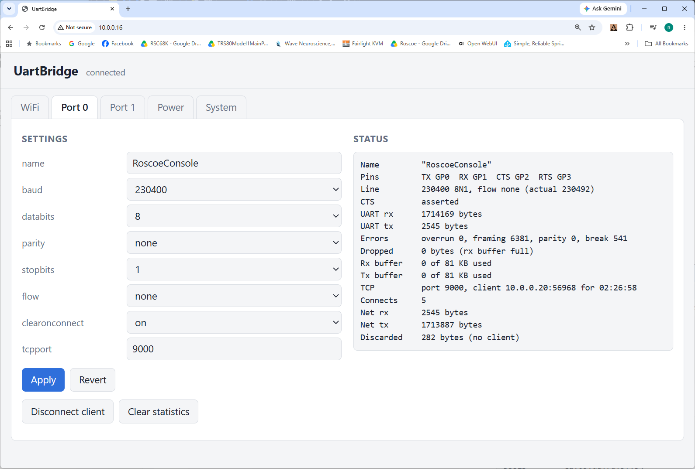
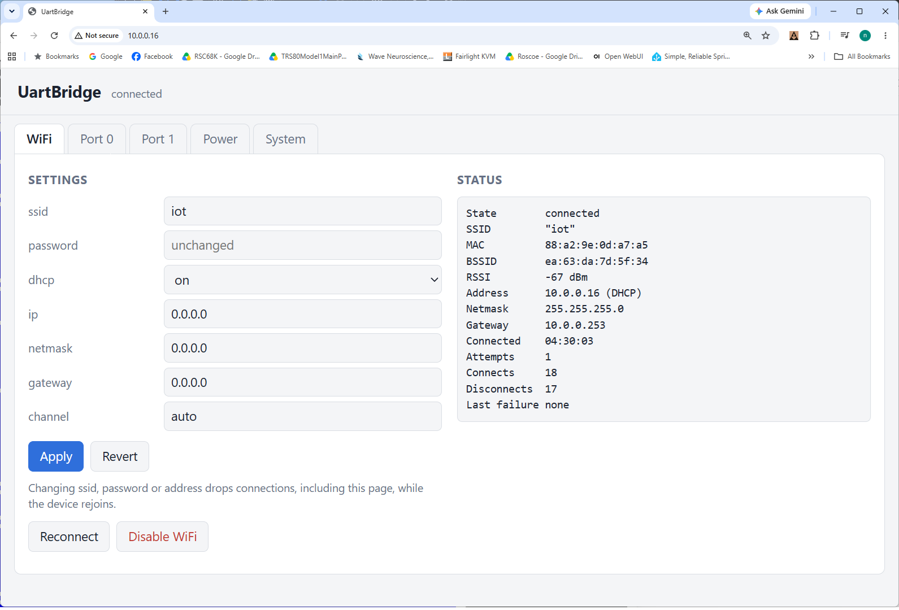
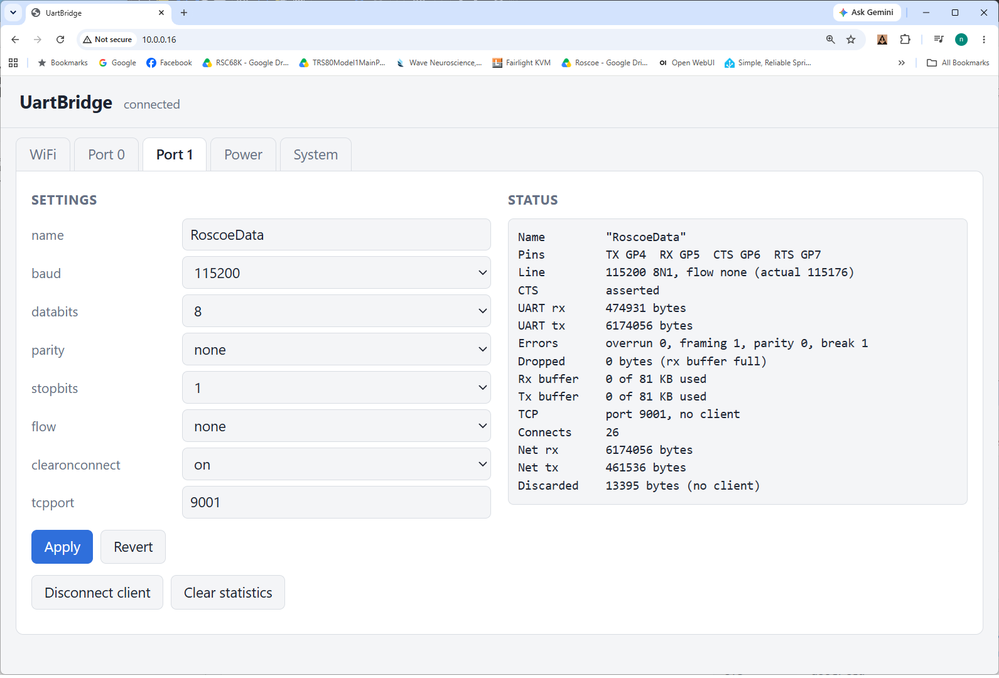
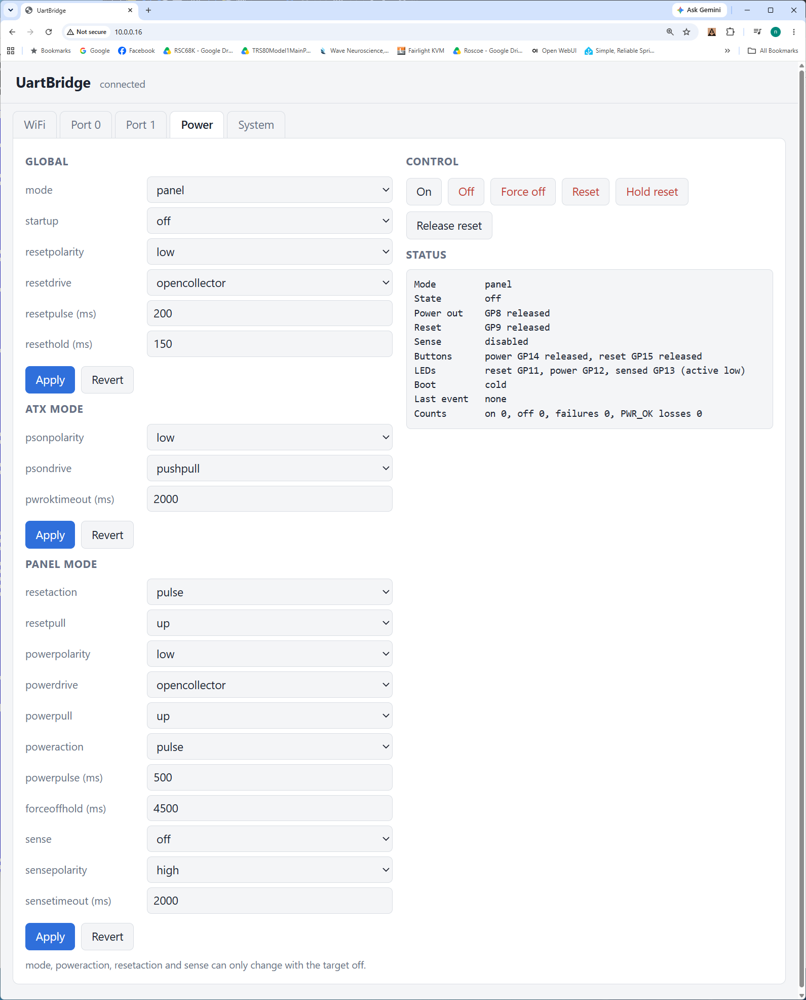
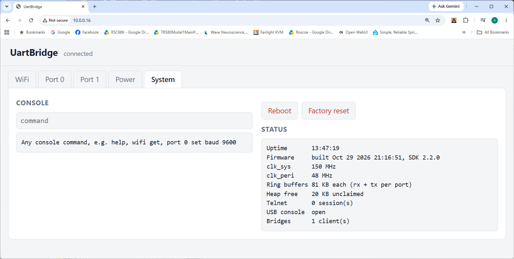

# UartBridge

A dual serial-port-to-WiFi bridge with target power and reset control, for the
Raspberry Pi **Pico W** (RP2040) and **Pico 2 W** (RP2350).

Each of the two hardware UARTs is exposed as a raw TCP port on your network. The
same board can also switch a target machine on and off and reset it: either by
driving an ATX power supply directly (PS_ON# / PWR_OK), or by standing in for a
front panel's power and reset buttons. The real front-panel buttons can be wired
through it so they keep working.

Everything is configured from a console that is reachable three ways at once: the
USB virtual COM port, telnet, and a built-in web page. Every change takes effect
immediately (nothing needs a reboot) and is saved to flash.

<p align="center">
  
</p>

**Just want to use it?** Ready-built firmware is in [`Binaries/`](Binaries):
download the file for your board and follow [Flashing](#flashing). No compiler
needed.

## Contents

* [Features](#features)
* [Hardware and pinout](#hardware-and-pinout)
* [Wiring](#wiring)
* [Prebuilt firmware](#prebuilt-firmware)
* [Building](#building)
* [Flashing](#flashing)
* [First-time setup](#first-time-setup)
* [Using the console](#using-the-console)
* [WiFi configuration](#wifi-configuration)
* [Serial port configuration](#serial-port-configuration)
* [Power control configuration](#power-control-configuration)
* [Web page](#web-page)
* [Command reference](#command-reference)
* [LEDs](#leds)
* [Architecture](#architecture)
* [License](#license)

## Features

* **Serial**
  * Two hardware UARTs with TX, RX, CTS and RTS.
  * 20 baud rates from 110 to 1152000, all within 0.2%.
  * 5 to 8 data bits; none, even, odd, mark or space parity; 1 or 2 stop bits.
  * RTS/CTS hardware flow control, carried end to end.
  * Ring buffers sized to use all spare RAM.
* **Network bridging**
  * One raw TCP listener per port.
  * Low latency for interactive use and full-size segments under load.
* **WiFi**
  * WPA2 or an open network; DHCP or static addressing; automatic or fixed channel.
  * Retries forever and rejoins automatically after a dropout.
* **Target power control**
  * ATX mode: PS_ON# / PWR_OK sequencing.
  * Panel mode: power and reset button emulation.
  * Optional power sensing.
  * Startup policy: off, on, or last state.
  * Front panel button pass-through and three status LEDs.
* **Fault handling**
  * A PWR_OK loss asserts reset within microseconds.
  * A failed power-up turns power off and flags it on an LED.
* **Reboots**
  * A software reboot of the bridge leaves the target's power and reset pins untouched.
* **Configuration**
  * USB console, telnet and a web page, all usable at the same time.
  * Settings persist across power loss.

## Hardware and pinout

Supported boards:

| Board | Chip | RAM | Ring buffers (each of 4) |
|---|---|---|---|
| Raspberry Pi Pico W | RP2040 | 264 KB | ~18 KB |
| Raspberry Pi Pico 2 W | RP2350 | 520 KB | ~83 KB |

Both boards behave the same; the Pico 2 W's larger buffers ride out longer WiFi
stalls at high baud rates without flow control. The plain Pico and Pico 2 (no
WiFi chip) are **not** supported.

Both boards have the same header, and every signal is on the same pin on each:

| GPIO | Header pin | Signal | Direction |
|---|---|---|---|
| GP0 | 1 | Port 0 TX | out |
| GP1 | 2 | Port 0 RX | in (pull-up) |
| GP2 | 4 | Port 0 CTS | in |
| GP3 | 5 | Port 0 RTS | out |
| GP4 | 6 | Port 1 TX | out |
| GP5 | 7 | Port 1 RX | in (pull-up) |
| GP6 | 9 | Port 1 CTS | in |
| GP7 | 10 | Port 1 RTS | out |
| GP8 | 11 | Power out: PS_ON# (ATX) or power button (panel) | out |
| GP9 | 12 | Reset out | out |
| GP10 | 14 | Power sense: PWR_OK (ATX) or power LED (panel) | in |
| GP11 | 15 | LED: reset asserted (sink, active low) | out |
| GP12 | 16 | LED: power asserted (sink, active low) | out |
| GP13 | 17 | LED: power sensed (sink, active low) | out |
| GP14 | 19 | Front panel power button (to GND) | in (pull-up) |
| GP15 | 20 | Front panel reset button (to GND) | in (pull-up) |

Ground is on header pins 3, 8, 13 and 18 (and others).

Electrical notes:

* All I/O is **3.3 V** and **not 5 V tolerant**. Use a level shifter or an
  RS-232 transceiver (e.g. MAX3232) for anything else.
* **PWR_OK** from an ATX supply is 5 V logic and needs a resistor divider.
* **PS_ON#** and many motherboard switch and reset lines are pulled up to 5 V.
  Never connect them straight to a GPIO; drive them through a transistor or an
  optocoupler, as shown in [Wiring](#wiring).
* While the Pico is powering up or in BOOTSEL mode, its pins are inputs with
  pull-downs. Fit external pull resistors that hold PS_ON#, reset and the power
  output at safe levels during that window. The transistor circuits below are
  already safe: an undriven base means the transistor is off.

Pin assignments are in `Source/Config.h`.

## Wiring

All the circuits below are suggestions; check your own equipment's voltages
first. "NPN" means a small signal transistor such as a 2N3904 or BC547. An
N-MOSFET such as a 2N7000 or BSS138 works the same way, with the gate resistor in
place of the base resistor. "Opto" means an optocoupler such as a PC817.

### 5 V and 3.3 V

The RP2040 and RP2350 are 3.3 V parts, and their GPIO pins are **not 5 V
tolerant**. A pin that sees more than about 3.6 V, even through a pull-up or
only while the pin is an input, conducts through its protection diodes into the
3.3 V rail. That can damage the Pico, or power it in odd ways. Rules of thumb:

* **Never connect a 5 V signal or a 5 V pull-up directly to a GPIO.** That
  includes ATX PS_ON#, PWR_OK, most motherboard front panel switch and reset
  lines, 5 V TTL serial devices, and RS-232.
* Measure before connecting: check the open-circuit voltage of any line with a
  multimeter.
* An "open collector" GPIO setting does **not** make a pin 5 V safe. When it is
  released, the pin is still exposed to whatever voltage the line is pulled up to.

**Inputs from 5 V** (PWR_OK, 5 V TTL RX, a 5 V sense signal): use a resistor
divider so 5 V becomes no more than 3.3 V.

```
5 V signal ──[ R1 ]──┬── GPIO
                     │
                  [ R2 ]
                     │
                    GND
```

| R1 | R2 | 5 V in gives | Notes |
|---|---|---|---|
| 10 kΩ | 18 kΩ | 3.2 V | Recommended general purpose |
| 10 kΩ | 20 kΩ | 3.3 V | Upper limit; fine for clean 5 V |
| 1 kΩ | 2 kΩ | 3.3 V | Faster edges, for serial above 230400 baud |
| 4.7 kΩ | 10 kΩ | 3.4 V | Avoid; marginal |

The RP2040/RP2350 reads anything above about 2 V as high, so there's plenty of
margin. A divider's impedance slows edges at high baud rates; for 5 V serial
faster than about 230400 baud, use a level shifter such as a 74LVC1T45 or
TXS0102, or the 1 kΩ / 2 kΩ divider.

**Outputs to 5 V**:

* A 3.3 V high is accepted by most 5 V TTL and HCT/ACT CMOS inputs, so a Pico TX
  can drive a 5 V TTL RX directly.
* 5 V CMOS (HC) inputs need about 3.5 V, so use a level shifter for those.
* For anything pulled up to 5 V (switch lines, PS_ON#, reset), drive it through
  an NPN, N-MOSFET or optocoupler. Don't drive it from the pin itself.

**Series resistors**: a 1 kΩ resistor between a GPIO and anything off-board
limits the current if something is miswired. It doesn't make 5 V safe on its own.

### Serial ports

The signals cross over: TX to RX, and RTS to CTS.

| Pico | Port 0 | Port 1 | Connects to the device's |
|---|---|---|---|
| TX (out) | GP0, pin 1 | GP4, pin 6 | RX |
| RX (in) | GP1, pin 2 | GP5, pin 7 | TX |
| RTS (out) | GP3, pin 5 | GP7, pin 10 | CTS |
| CTS (in) | GP2, pin 4 | GP6, pin 9 | RTS |
| GND | pin 3 | pin 8 | GND |

* **3.3 V TTL devices** connect directly.
* **5 V TTL devices**: the Pico's TX and RTS can usually drive the device's
  inputs directly. The device's TX and RTS must be brought down to 3.3 V before
  they reach the Pico's RX and CTS: a 10 kΩ / 18 kΩ divider, or a level shifter
  above 230400 baud (see [5 V and 3.3 V](#5-v-and-33-v)).
* **RS-232 (±12 V)**: use a transceiver such as a MAX3232 powered from 3V3 OUT
  (pin 36). It handles TX/RX and RTS/CTS.
* **Without flow control**: CTS and RTS can be left unconnected.

### Power control: panel mode

In panel mode the bridge sits between the case's front panel and the
motherboard's front panel header. On the common Intel-style 10-pin header:

| Header pin | Signal |
|---|---|
| 2 / 4 | Power LED + / − |
| 5 / 7 | Reset switch: ground / signal |
| 6 / 8 | Power switch: signal / ground |

Header layouts vary; check the motherboard manual.

Switch lines are pulled up on the motherboard, often to 5 V, so they must not
reach a GPIO. The recommended circuit uses an optocoupler for each switch. The
GPIO sinks the opto's LED current, and the opto's transistor goes across the
switch pins. It isolates the bridge completely and works with the **default**
settings (active low, open collector):

```
3V3 OUT (pin 36) ──[330 Ω]── opto LED anode,  opto LED cathode ── GP8
opto collector ── motherboard power switch signal (pin 6)
opto emitter   ── motherboard power switch ground (pin 8)
```

Wire GP9 to the reset switch (pins 7 / 5) the same way. A pressed button is the
GPIO pulling low, which turns the opto on and shorts the switch pins. While the
Pico boots, the pins float and the optos stay off.

Settings for this circuit are the defaults, but to set them explicitly:

```
power set mode panel powerpolarity low powerdrive opencollector powerpull none
power set resetpolarity low resetpull none resetaction pulse
```

Use `powerpull none` and `resetpull none` here: an internal pull-up would hold
the pin high anyway, but a pull-down would light the opto slightly.

An NPN transistor also works for the **power** output (and for a level reset),
but not for a pulsed reset. A pulsed reset is always open collector, which can't
drive a transistor's base high:

```
GP8 ──[1 kΩ]──┬── B  NPN   C ── motherboard power switch signal (pin 6)
              │          E ── motherboard ground (pin 8)
           [10 kΩ]
              │
             GND
```

```
power set powerpolarity high powerdrive pushpull powerpull none
```

**Power sense (optional)**: let the motherboard's power LED output light an opto
instead of, or in series with, the case LED. The opto's transistor then pulls
GP10 low when the target is on:

```
motherboard PWR LED + ── opto LED ── PWR LED −
GP10 ── opto collector,   opto emitter ── GND
```

Most boards already have a current-limiting resistor on the LED output; if yours
doesn't, add about 330 Ω in series.

```
power set sense on sensepolarity low
```

With `sensepolarity low` the firmware enables GP10's internal pull-up, so no
external pull-up is needed.

**Level reset for older machines** (`resetaction level`): GP9 drives the
motherboard's reset line, holding it while the target is off and releasing it
`resethold` ms after power comes up. Use the NPN circuit above, with
`resetpolarity high resetdrive pushpull`. If the reset line is a 3.3 V signal,
you can instead connect it directly with `resetpolarity low resetdrive opencollector`.

### Power control: ATX mode

In ATX mode the bridge controls the supply directly. On the 24-pin ATX connector:

| ATX pin | Wire colour | Signal |
|---|---|---|
| 16 | green | PS_ON# (pull low = supply on) |
| 8 | grey | PWR_OK (5 V when power is good) |
| 9 | purple | +5VSB (always on) |
| 3, 5, 7, 15, 17, 18, 19, 24 | black | Ground |

**PS_ON#**: through an NPN, so the PSU's 5 V pull-up never reaches the Pico.

```
GP8 ──[1 kΩ]──┬── B  NPN   C ── PS_ON# (pin 16, green)
              │          E ── ATX ground
           [10 kΩ]
              │
             GND
```

The 10 kΩ pull-down keeps the supply off while the Pico is booting or in BOOTSEL
mode.

**PWR_OK**: through a divider, from 5 V to about 3.2 V. Never connect it directly.

```
PWR_OK (pin 8, grey) ──[10 kΩ]──┬── GP10
                                │
                             [18 kΩ]
                                │
                               GND
```

**Reset**: drive the target's reset the same way as in panel mode, through an NPN
to the reset switch or reset line.

**Ground**: the Pico's ground must be common with the ATX ground.

The Pico can be powered from +5VSB (purple) into VSYS (pin 39). It then stays up
while the supply is off, which it must, to be able to turn the supply on.

Matching settings:

```
power set mode atx psonpolarity high psondrive pushpull
power set resetpolarity high resetdrive pushpull
```

### Front panel buttons (optional)

To keep the case's own power and reset buttons working, wire them to the bridge
instead of the motherboard. The bridge then passes them through.

| Button | Wire between | Notes |
|---|---|---|
| Power | GP14 (pin 19) and GND (pin 18) | Internal pull-up, 10 ms debounce |
| Reset | GP15 (pin 20) and GND (pin 18) | Internal pull-up, 10 ms debounce |

* Plain switch contacts go straight to the pins; don't connect them to the
  motherboard as well.
* In panel pulse mode, power button presses are mirrored onto the power output,
  so the motherboard sees the real press, including press-and-hold.
* In ATX mode and panel level mode, each press of the power button toggles power
  on or off.
* The reset button holds the target in reset for as long as it's pressed.

### Status LEDs (optional)

The LED outputs sink current: low means on.

```
3V3 OUT (pin 36) ──[470 Ω]── LED anode, LED cathode ── GP11 / GP12 / GP13
```

| GPIO | Header pin | LED |
|---|---|---|
| GP11 | 15 | Reset asserted |
| GP12 | 16 | Power asserted; blinks at 1 Hz after a power failure |
| GP13 | 17 | Power sensed |

Keep the current to a few mA; 470 Ω to 1 kΩ suits most LEDs.

## Prebuilt firmware

The [`Binaries/`](Binaries) directory holds ready-to-flash images built from this
source:

| File | Board | Chip |
|---|---|---|
| [`UartBridge-PicoW-RP2040.uf2`](Binaries/UartBridge-PicoW-RP2040.uf2) | Raspberry Pi Pico W | RP2040 |
| [`UartBridge-Pico2W-RP2350.uf2`](Binaries/UartBridge-Pico2W-RP2350.uf2) | Raspberry Pi Pico 2 W | RP2350 |

Pick the file for your board; each chip ignores the other's image. Both need the
**W** (WiFi) version of the board; the plain Pico and Pico 2 won't run them. To
download one from GitHub, open the file and use the download button.

To build them yourself, or after changing the source, see [Building](#building).

## Building

You need a Linux, FreeBSD or macOS host with:

* `cmake` 3.13 or later
* `ninja`
* `arm-none-eabi-gcc` with newlib (e.g. Ubuntu packages `gcc-arm-none-eabi`
  and `libnewlib-arm-none-eabi`)
* `git`
* `python3`
* a host C/C++ compiler (for picotool)

The build downloads its own copy of the Pico SDK (2.2.0) and picotool into the
build directory, so nothing is installed system-wide. A `PICO_SDK_PATH`
environment variable is ignored.

Use a separate build directory for each board:

**Pico 2 W (RP2350)** is the default:

```
mkdir build && cd build
cmake -G Ninja ..
ninja
```

**Pico W (RP2040):**

```
mkdir build-picow && cd build-picow
cmake -G Ninja -DPICO_BOARD=pico_w ..
ninja
```

Each build produces `UartBridge.uf2` in its build directory. The first configure
takes a little while as the SDK is cloned. After that, `ninja` alone rebuilds
after any source change, re-running CMake itself if needed.

To use an existing SDK (2.1.0 or later) instead of the downloaded one, pass
`-DPICO_SDK_PATH=/path/to/pico-sdk` to `cmake`.

To refresh the prebuilt images in `Binaries/` after a change, build both boards,
then from the project directory:

```
cp build/UartBridge.uf2       Binaries/UartBridge-Pico2W-RP2350.uf2
cp build-picow/UartBridge.uf2 Binaries/UartBridge-PicoW-RP2040.uf2
```

The two images are **not** interchangeable: each chip ignores the other's image.

| Build directory | Board | BOOTSEL drive name |
|---|---|---|
| `build/` | Pico 2 W | `RP2350` |
| `build-picow/` | Pico W | `RPI-RP2` |

## Flashing

1. Hold **BOOTSEL** and plug the board into USB, then release the button. A USB
   drive appears, named `RP2350` or `RPI-RP2`.
2. Copy the matching image onto it:

   | Drive | Board | Prebuilt image | Or your own build |
   |---|---|---|---|
   | `RPI-RP2` | Pico W | `Binaries/UartBridge-PicoW-RP2040.uf2` | `build-picow/UartBridge.uf2` |
   | `RP2350` | Pico 2 W | `Binaries/UartBridge-Pico2W-RP2350.uf2` | `build/UartBridge.uf2` |

3. The board reboots into the firmware and the drive disappears.

If the drive stays put after the copy, the image is for the other chip.
`INFO_UF2.TXT` on the drive shows which chip you have.

If the board is already running UartBridge, `system bootsel` from any console puts
it into BOOTSEL mode without touching the button.

## First-time setup

1. **Flash** the firmware as above. With no settings stored, the board starts with
   defaults: WiFi enabled but no network configured, both ports at 115200 8N1 with
   no flow control on TCP ports 9000 and 9001, and target power control in panel
   mode with power left off.
2. **Open the USB console.** The board appears as a USB serial device: a COM port
   on Windows, `/dev/ttyACM*` on Linux, `/dev/cuaU*` on FreeBSD. Open it with any
   terminal program (PuTTY, Tera Term, `screen`, `minicom`, `cu`). The baud rate
   setting doesn't matter. You'll see:
   ```
   UartBridge (built ...)
   Type 'help' for commands.
   >
   ```
3. **Join your WiFi network:**
   ```
   > wifi set ssid "MyNetwork" password "MyPassphrase"
   ```
   The bridge starts joining immediately. Progress messages appear on the console.
4. **Find its address:**
   ```
   > wifi stats
   State        connected
   SSID         "MyNetwork"
   MAC          28:cd:c1:xx:xx:xx
   Address      192.168.1.57 (DHCP)
   ...
   ```
   The DHCP hostname is `UartBridge`. The MAC address is shown even before the
   board joins, so you can set up a DHCP reservation first.
5. **Configure the serial ports** (see below), for example:
   ```
   > port 0 set baud 9600 name "Router console"
   ```
6. **Connect** a raw TCP client to `<address>:9000` for port 0 or `:9001` for
   port 1. Use `nc`, `socat`, or PuTTY in **Raw** mode, not Telnet mode (see
   [Data connections](#data-connections)).

From here on, the same console is available over the network with
`telnet <address>`, and in a browser at `http://<address>/`.

## Using the console

* Commands are `<area> <action> [arguments]`. The areas are `wifi`, `port`,
  `power` and `system`.
* Typing an area on its own, or an incomplete command, prints its usage:
  ```
  > wifi
  Usage: wifi <subcommand>
    disable    Disconnect and stay off
    enable     Connect again (resets statistics)
    ...
  ```
* `set` accepts any number of `<name> <value>` pairs, which are checked and
  applied together. If any value is invalid, nothing changes:
  ```
  > port 1 set baud 38400 databits 7 parity even stopbits 1
  ```
* `set` on its own lists that area's settings and their allowed values.
* `get` with no name lists every setting in an area; `get <name>` prints one value.
* `reset` (WiFi, ports) or `default` (power) puts settings back to their defaults:
  all of them, or only the ones named.
* Values containing spaces go in double quotes. Inside quotes, `\"` is a quote
  and `\\` is a backslash. Use `""` for an empty value.
* Command and setting names are not case-sensitive. Values like SSIDs and names are.
* On/off settings also accept `yes`/`no`, `true`/`false`, `enable`/`disable` and `1`/`0`.
* Line editing: Backspace deletes; Ctrl-C or Ctrl-U discards the line.
* Status messages (WiFi joined, client connected, power events) appear on every
  open console without disturbing what you are typing.
* Every change is saved to flash and takes effect immediately.
* Any number of telnet sessions can be open alongside the USB console and the web
  page. `exit` closes a telnet session.

## WiFi configuration

<p align="center">
  
</p>

```
wifi set ssid "MyNetwork" password "MyPassphrase"
```

| Setting | Values | Default | Notes |
|---|---|---|---|
| `ssid` | text, up to 32 characters | (none) | Network name |
| `password` | 8–63 characters, or `""` | (none) | WPA2 passphrase; `""` joins an open network |
| `dhcp` | `on` \| `off` | `on` | `off` uses `ip` / `netmask` / `gateway` |
| `ip` | `a.b.c.d` | 0.0.0.0 | Static address |
| `netmask` | `a.b.c.d` | 0.0.0.0 | Static netmask; must be contiguous |
| `gateway` | `a.b.c.d` | 0.0.0.0 | Static gateway |
| `channel` | `auto` \| `1`–`13` | `auto` | Join only on this channel |

Static addressing:

```
wifi set dhcp off ip 10.0.0.50 netmask 255.255.255.0 gateway 10.0.0.1
```

Behaviour:

* Changing `ssid`, `password` or `channel` rejoins immediately.
* Changing `dhcp`, `ip`, `netmask` or `gateway` readdresses the interface
  immediately, without rejoining.
* Either kind of change drops network sessions, including the telnet session or
  web page you made it from. Set related values together in one `set`.
* After a join fails, the bridge waits 2 s and tries again, indefinitely. A join
  attempt that hasn't completed in 30 s counts as failed. If the link drops, it rejoins.
* `wifi disable` leaves the network and stays off, and this is saved. `wifi enable` resumes.
* `wifi scan` lists nearby networks, strongest first, with channel, signal and
  security. Scan results only appear on the USB console and telnet, not the web page.
* `wifi stats` shows:
  * state and SSID
  * MAC address, plus the access point's BSSID and the signal strength (RSSI)
  * address, netmask and gateway
  * time connected
  * join attempts, connects and disconnects
  * the reason for the last failure: bad password, network not found, no IP address, or timeout

## Serial port configuration

<p align="center">
  
  
</p>

Ports are numbered `0` and `1`.

```
port 0 set baud 115200 databits 8 parity none stopbits 1 flow none
```

| Setting | Values | Default | Notes |
|---|---|---|---|
| `baud` | see below | `115200` | |
| `databits` | `5` \| `6` \| `7` \| `8` | `8` | |
| `parity` | `none` \| `even` \| `odd` \| `mark` \| `space` | `none` | |
| `stopbits` | `1` \| `2` | `1` | |
| `flow` | `none` \| `rtscts` | `none` | Hardware flow control |
| `tcpport` | `0`–`65535` | 9000 + port number | `0` turns the port's listener off |
| `clearonconnect` | `on` \| `off` | `on` | See below |
| `name` | text, up to 32 characters | (none) | A label for the port; `""` clears it |

Supported baud rates:

```
110 300 600 1200 2400 4800 9600 14400 19200 38400 56000 57600
115200 128000 230400 256000 460800 921600 1000000 1152000
```

Line settings take effect on the next character without dropping the TCP client.
Changing `tcpport` moves the listener immediately and drops any connected client.
A port's TCP port can't be 23 (telnet), 80 (the web page), or the other port's TCP port.

### Data connections

* Each port has one raw TCP listener. Bytes pass through unchanged in both
  directions; there is no telnet negotiation and no line-ending translation.
* Connect with a raw client: `nc <address> 9000`, `socat`, PuTTY in **Raw** mode,
  or a socket in your own program. A client in Telnet mode will insert and remove
  bytes.
* One client at a time. A new connection replaces the existing one.
* Serial data going to the network is sent at once when the link is idle. Under
  load it is packed into full-size TCP segments, held for at most 2 ms. This
  avoids stalls on clients that delay acknowledgements.
* Dead clients are detected with TCP keepalive: 10 s idle, then 3 probes 2 s apart.

### Flow control

* With `flow rtscts`:
  * If the bridge's receive buffer fills, it stops reading the UART, and the
    UART deasserts RTS on its own.
  * Data from the network is held in TCP when the transmit buffer is full: the
    TCP window closes and the sender waits.
  * No data is lost in either direction.
  * CTS from the device pauses transmission.
* With `flow none`, RTS is held asserted and CTS is ignored. Data from the network
  is still never lost: TCP holds it. Serial data arriving with the receive buffer
  full is dropped, and counted as "Dropped" in `port N stats`.

### clearonconnect

* `on`: serial data that arrives while no client is connected is discarded, so
  each new client starts clean. The amount is counted as "Discarded".
* `off`: that data is kept and sent to the next client, up to the buffer size.
  Once the buffer is full, `flow rtscts` holds the device off; without flow
  control, further bytes are dropped.

### Statistics

`port N stats` shows:

* the port's name and pins
* the line settings, and the actual baud rate achieved
* the CTS state
* UART bytes received and transmitted
* overrun, framing, parity and break counts
* dropped bytes
* receive and transmit buffer use
* the TCP port and connected client, and how long it has been connected
* the connection count, network bytes each way, and discarded bytes

`port N clear` resets the counters.

## Power control configuration

<p align="center">
  
</p>

The bridge controls one target machine through GP8 (power), GP9 (reset) and GP10
(sense). There are two modes, selected with `power set mode`; the default is
`panel`. Settings are in three groups: global (used by both modes), ATX-only and
panel-only.

The mode, and the settings that change what "on" means (`poweraction`,
`resetaction`, `sense`), can only be changed while the target is off.

### Panel mode (default)

The bridge replaces the front panel's buttons, mimicking a person pressing them.

* **Power output (GP8)**:
  * `poweraction pulse` (default): a button press of `powerpulse` ms.
  * `poweraction level`: the output is held asserted for as long as the target
    should be on, e.g. to drive a relay.
  * Polarity, drive (push-pull or open collector) and pull are configurable.
* **Forced off**: `power forceoff` holds the power button for `forceoffhold` ms
  (4.5 s by default), the press-and-hold override that forces a PC off.
* **Reset output (GP9)**:
  * `resetaction pulse` (default): an open-collector button press of
    `resetpulse` ms.
  * `resetaction level`: for older machines where the output drives the
    motherboard's reset line directly. Reset is held while the target is off or
    coming up, and released `resethold` ms after it comes on. It is not asserted
    during a shutdown. Uses the global `resetdrive`.
  * Level reset needs to know when the target is really on, so it requires
    `sense on` or `poweraction level`.
* **Power sensing (GP10)**: optional, e.g. from the power LED header.
  * Turn it on with `sense on`; set the level that means "on" with `sensepolarity`.
  * Power-up check: if power isn't sensed within `sensetimeout` ms, the power-up
    is undone. A level output is released; a pulse output gets a press-and-hold
    override. The power LED then blinks at 1 Hz.
  * Changes made outside the bridge, by the real button or an OS shutdown, are
    tracked.
  * Without sensing, the bridge only assumes the target's state.

Example: a PC front panel with the power LED wired to the sense input:

```
power set mode panel poweraction pulse resetaction pulse sense on sensepolarity high
```

### ATX mode

The bridge drives an ATX supply's PS_ON# directly and watches PWR_OK.

* **Power on**:
  1. PS_ON# is asserted, and reset is held.
  2. PWR_OK is awaited.
  3. Reset is held a further `resethold` ms (default 150), then released.
* **No PWR_OK**: if PWR_OK doesn't arrive within `pwroktimeout` ms (default
  2000, in 100 ms steps), PS_ON# is released and power is left off. The power LED
  blinks at 1 Hz.
* **Power off**: reset is always asserted before PS_ON# is released.
* **Reset while off**: reset is asserted whenever the target is not fully on, and
  is never released without PWR_OK.
* **PWR_OK loss while running**:
  * The bridge's second core asserts reset within microseconds, even while the
    first core is writing settings to flash.
  * PS_ON# is then released, power stays off, and the power LED blinks at 1 Hz.
* PS_ON# polarity and drive are configurable.

Example:

```
power set mode atx psondrive opencollector resethold 150 pwroktimeout 2000
```

### Global behaviour (both modes)

* **Reset output**: polarity `resetpolarity`, drive `resetdrive`. Panel pulse
  reset is always open collector.
* **Startup policy**: `startup off | on | last`, applied when the bridge powers
  up. With `on` or `last` in ATX mode or with a level power output, the output is
  asserted from the first moment of boot, so the target isn't power-cycled. In
  panel pulse mode without sensing, `on` and `last` press the power button once,
  which would turn off a target that was already running.
* **Failures**: a failed power-up or a PWR_OK loss sets the remembered "last
  state" to off. `startup last` will therefore not retry a faulty supply.
* **Failure indication**: the power LED (GP12) blinks at 1 Hz after a failed
  power-up or an unexpected loss of power, until the next attempt to power up.
* **Front panel pass-through**:
  * In panel pulse mode, the real power button (GP14) is mirrored onto the
    power output.
  * In ATX mode and panel level mode, the power button toggles power on and off.
  * The reset button (GP15) holds reset for as long as it's pressed, in both modes.
* **Bridge reboots**:
  * A software reboot (`system reboot`, or a reboot after a crash) leaves the
    power, reset and LED pins exactly as they were, and picks the power state
    back up. `power stats` shows "Boot: warm".
  * If PWR_OK was lost before or during the reboot, the bridge comes up with
    power off and the failure flagged. A reboot never undoes a fault.
  * Power-on, the RUN pin and BOOTSEL (including a firmware update) do reset
    the pins in hardware.

### Settings

| Group | Setting | Values | Default | Description |
|---|---|---|---|---|
| Global | `mode` | `panel` \| `atx` | `panel` | Front panel buttons or ATX supply (target must be off) |
| Global | `startup` | `off` \| `on` \| `last` | `off` | Power state applied when the bridge starts |
| Global | `resetpolarity` | `low` \| `high` | `low` | Reset asserted level |
| Global | `resetdrive` | `pushpull` \| `opencollector` | `opencollector` | Reset drive (panel pulse reset is always open collector) |
| Global | `resetpulse` | ms | `200` | Length of a `power reset` pulse |
| Global | `resethold` | ms | `150` | Reset held after power comes up (ATX; panel level reset) |
| ATX | `psonpolarity` | `low` \| `high` | `low` | PS_ON# asserted level |
| ATX | `psondrive` | `pushpull` \| `opencollector` | `pushpull` | PS_ON# drive |
| ATX | `pwroktimeout` | ms, 100 ms steps | `2000` | PS_ON# released if PWR_OK hasn't arrived |
| Panel | `poweraction` | `pulse` \| `level` | `pulse` | Button press, or held while on (target must be off) |
| Panel | `powerpulse` | ms | `500` | Power button press length |
| Panel | `forceoffhold` | ms, 100 ms steps | `4500` | Press-and-hold length for `power forceoff` |
| Panel | `powerpolarity` | `low` \| `high` | `low` | Power output asserted level |
| Panel | `powerdrive` | `pushpull` \| `opencollector` | `opencollector` | Power output drive |
| Panel | `powerpull` | `none` \| `up` \| `down` | `up` | Pull on the power output |
| Panel | `resetaction` | `pulse` \| `level` | `pulse` | Button press, or reset line held while not on (target must be off; needs `sense on` or `poweraction level`) |
| Panel | `resetpull` | `none` \| `up` \| `down` | `up` | Pull on the reset output |
| Panel | `sense` | `on` \| `off` | `off` | Power sense input in use (target must be off) |
| Panel | `sensepolarity` | `high` \| `low` | `high` | Sense level that means power is on |
| Panel | `sensetimeout` | ms, 100 ms steps | `2000` | Power-up undone if power isn't sensed by then |

Settings marked "100 ms steps" must be a multiple of 100. All times except
`resethold` must be greater than 0.

## Web page

Browse to `http://<address>/`. There is no password; anyone who can reach port 80
can use it.

Each area of the device has its own page, shown in the section that covers it:

* [WiFi](#wifi-configuration)
* [Port 0 and Port 1](#serial-port-configuration)
* [Power](#power-control-configuration)
* [System](#system-page)

On every page:

* **Forms:** each group shows the current values. Changed fields are highlighted,
  and **Apply** sends them all in one `set`; **Revert** reloads the values.
* **Status:** the matching `stats` output, refreshed every 3 seconds.
* **Buttons:**
  * Power: on, off, force off, reset, hold reset, release reset.
  * Ports: disconnect client, clear statistics.
  * WiFi: reconnect, disable.
  * System: reboot, factory reset.
  * Destructive actions ask for confirmation.
* **Console:** a command box on the System page runs any console command.

### System page

<p align="center">
  
</p>

The System page has a box for any console command, the reboot and factory reset
buttons, and the `system stats` output.

### How it works

Every action on the page is an ordinary console command, sent with an HTTP POST
to `/cmd`. Validation, saving and the immediate effect are therefore exactly the
same as from the USB console or telnet, and the console's reply is shown on the
page. The same endpoint can be scripted:

```
curl -d 'power on' http://<address>/cmd
curl -d 'port 0 stats' http://<address>/cmd
```

The page is `Source/Web/index.html`. It is embedded into flash at build time and
rebuilt automatically when it changes.

## Command reference

`<n>` is a port number (`0` or `1`). `[ ]` marks an optional argument; `...`
means it can be repeated.

### General

| Command | Description |
|---|---|
| `help` or `?` | List the command areas |
| `exit` | Close this telnet session (telnet only) |

### wifi

| Command | Description |
|---|---|
| `wifi` | Usage |
| `wifi set <name> <value> [<name> <value> ...]` | Change settings and apply them now |
| `wifi set` | List the settings and their allowed values |
| `wifi get [<name>]` | Show all settings, or one |
| `wifi reset [<name> ...]` | Settings back to defaults (all, or the ones named) |
| `wifi stats` | State, SSID, MAC, BSSID, RSSI, address, netmask, gateway, time connected, attempts, connects, disconnects, last failure |
| `wifi scan` | List networks in range |
| `wifi reconnect` | Leave and rejoin; resets the statistics |
| `wifi disable` | Leave the network and stay off (saved) |
| `wifi enable` | Join again (saved); resets the statistics |

WiFi settings: `ssid`, `password`, `dhcp`, `ip`, `netmask`, `gateway`, `channel`,
described in [WiFi configuration](#wifi-configuration).

### port

| Command | Description |
|---|---|
| `port` | Usage |
| `port <n> set <name> <value> [<name> <value> ...]` | Change settings and apply them now |
| `port <n> set` | List the settings, their allowed values and the supported baud rates |
| `port <n> get [<name>]` | Show all settings, or one |
| `port <n> reset [<name> ...]` | Settings back to defaults (all, or the ones named) |
| `port <n> stats` | Line, pins, CTS, byte and error counters, buffers, TCP client |
| `port <n> clear` | Reset the statistics |
| `port <n> disconnect` | Drop the connected TCP client |

Port settings: `baud`, `databits`, `parity`, `stopbits`, `flow`, `tcpport`,
`clearonconnect`, `name`, described in
[Serial port configuration](#serial-port-configuration).

### power

| Command | Description |
|---|---|
| `power` | Usage |
| `power on` | Power the target on (ATX sequence, or a button press / level output) |
| `power off` | Power off: ATX releases PS_ON# after asserting reset; panel presses the button (or releases the level output) |
| `power forceoff` | Panel pulse mode: hold the power button for `forceoffhold`. Other modes: same as `off` |
| `power reset` | Pulse reset for `resetpulse` |
| `power reset hold` | Assert reset and keep it asserted |
| `power reset release` | Release a held reset |
| `power stats` | Mode, state, failure flag, pin states, buttons, warm/cold boot, last event, counters |
| `power set <name> <value> [<name> <value> ...]` | Change settings and apply them now |
| `power set` | List the settings and their allowed values, grouped Global / ATX / Panel |
| `power get [<name>]` | Show all settings (with the active group marked), or one |
| `power default [<name> ...]` | Settings back to defaults (all, or the ones named); the remembered last state is kept |

Power settings: listed in [Power control configuration](#settings).

### system

| Command | Description |
|---|---|
| `system` | Usage |
| `system stats` | Uptime, firmware build, clocks, buffer sizes, free memory, telnet sessions, USB console, bridge clients |
| `system reboot` | Restart the bridge (the target's pins are kept) |
| `system bootsel` | Reboot into the USB bootloader for a firmware update |
| `system reset` | Restore every setting to its default (the target must be off) |

### Network ports used

| Port | Use |
|---|---|
| 23 | Telnet console |
| 80 | Web page and `/cmd` |
| 9000 | Serial port 0 (default, set with `port 0 set tcpport`) |
| 9001 | Serial port 1 (default, set with `port 1 set tcpport`) |

## LEDs

On-board LED (WiFi and data):

| Pattern | Meaning |
|---|---|
| 1 Hz, 50/50 | Not connected; joining WiFi |
| On, brief off-wink each second | Connected, no serial data |
| 4 Hz, 50/50 | Connected, serial data moving (held 500 ms after the last byte) |
| Off | WiFi disabled |

External status LEDs (sink, active low, so wire them from 3.3 V through a resistor to the pin):

| GPIO | On when |
|---|---|
| GP11 | Reset is asserted |
| GP12 | The power output is asserted. Blinks at 1 Hz after a failed power-up or a loss of power, until the next power-up attempt |
| GP13 | Power is sensed (PWR_OK, or the panel sense input) |

## Architecture

* Bare metal on the Pico SDK; no RTOS.
* **Core 0** runs the WiFi driver and lwIP stack (polled), the TCP bridges, the
  telnet, USB and web consoles, and the power state machine.
* **Core 1** runs entirely from RAM:
  * It moves bytes between both UARTs' FIFOs and the ring buffers.
  * In ATX mode it watches PWR_OK and asserts reset on loss.
  * Because it never touches flash, settings writes don't stall serial traffic or
    the PWR_OK guard.
* **Ring buffers**: after startup, all remaining heap except a 32 KB reserve is
  split into four equal buffers, one receive and one transmit for each port.
* **UART clock**: 48 MHz from the USB PLL on both chips. 110 baud fits the
  divisor, and every rate is within 0.2%.
* **Settings**: kept in two flash sectors at the top of flash, written alternately
  with a sequence number and CRC. A power cut during a save can't lose them.
  Settings from older firmware versions are converted automatically.
* **Pins across reboots**:
  * The power, reset and LED outputs are driven through the GPIO block's output
    overrides.
  * Software reboots skip resetting the GPIO and pad blocks, both in the reboot
    and in the boot-time resets (`Source/BootResets.c`).
  * The power state rides through the reboot in a watchdog scratch register.

### Source layout

| File | Purpose |
|---|---|
| `Source/Main.c` | Startup order, main loop, pin-preserving reboot |
| `Source/Uart.c` | UART setup and the core 1 FIFO / ring loop |
| `Source/Ring.h` | Lock-free single-producer / single-consumer ring buffer |
| `Source/Bridge.c` | TCP listeners and data pumping for each port |
| `Source/Wifi.c` | WiFi join / retry state machine, scan, on-board LED |
| `Source/Power.c` | Target power / reset control, PWR_OK guard, status LEDs, buttons |
| `Source/BootResets.c` | Boot-time peripheral resets that leave the GPIO block alone |
| `Source/Settings.c` | Flash storage, defaults, migration |
| `Source/Commands.c` | All console commands |
| `Source/Console.c` | Console sessions, line editing, message broadcast |
| `Source/Telnet.c` | Telnet server |
| `Source/Http.c` | Web server |
| `Source/Web/index.html` | The web page (embedded at build time) |
| `Source/UsbConsole.c`, `UsbDescriptors.c` | USB CDC console |
| `Source/Config.h` | Pins, ports and tunables |
| `Source/lwipopts.h`, `tusb_config.h` | lwIP and TinyUSB configuration |
| `Binaries/` | Prebuilt firmware images |
| `Docs/Images/` | Screenshots used in this README |

## License

BSD 3-Clause. Copyright (c) 2026, Neil Bradley. See [LICENSE](LICENSE).

The Pico SDK, TinyUSB, lwIP and the CYW43 driver are fetched at build time and
are covered by their own licenses. Note that the CYW43 WiFi driver from Raspberry
Pi is licensed for use only on Raspberry Pi RP-series devices.
